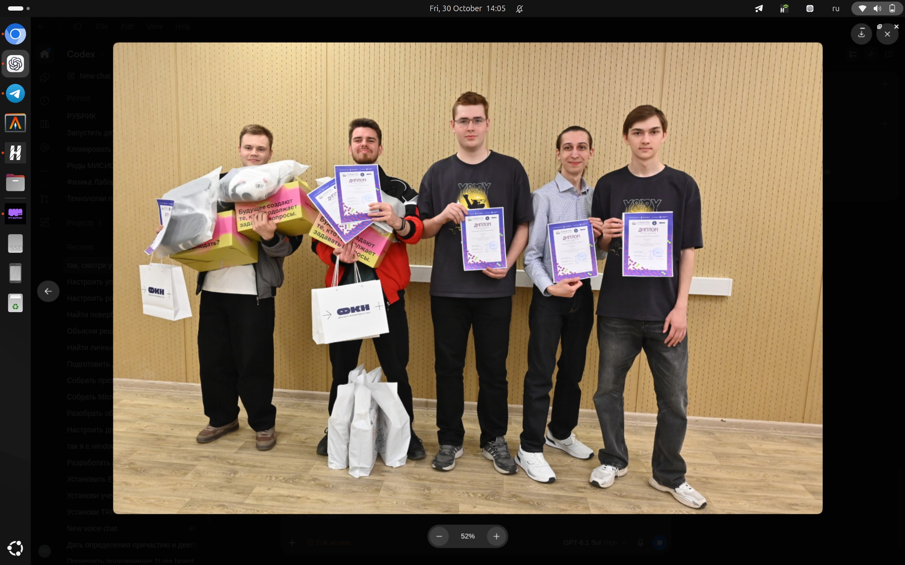
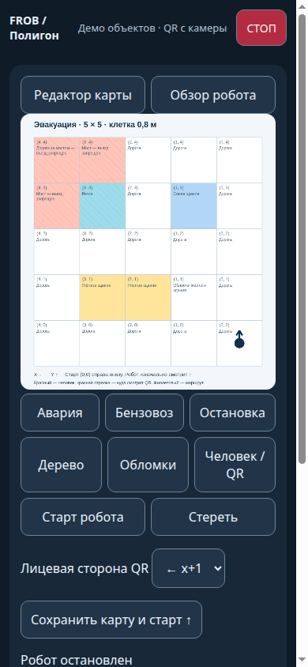
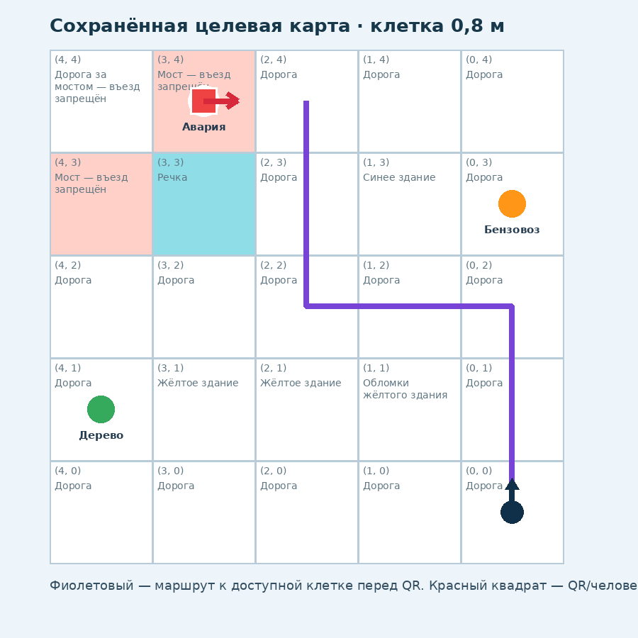

# RTC Evacuation — автономный поиск пострадавшего

> Соревновательный робот MISIS_Team для хакатона «Эвакуация» в рамках
> «Кубка РТК: Высшая лига» на Международном фестивале робототехники
> «РобоФинист — 2026».


## Результат

🥇 **1 место — MISIS_Team**

Команда студентов Роболабы НИТУ МИСИС:

- Ромазанов Артём — БПМ-25-6-2;
- Симакова Анастасия — БПМ-25-6-2;
- Михайленко Ярослав — МПМ-26-1.

На «РобоФинисте — 2026» студенты Роболабы НИТУ МИСИС завоевали две
награды и помогли школьным командам получить ещё три призовых места.
Фестиваль в Кронштадте объединил более 1000 участников из России и стран
Содружества.



## Задача хакатона

После чрезвычайной ситуации робот должен автономно найти пострадавшего по
текстовому описанию местности. На этапе подготовки оператор составляет
семантическую карту: отмечает здания, мосты и временные объекты — ДТП,
бензовоз, остановку, дерево и обломки. Во время заезда система разбирает
задание, строит маршрут, подъезжает к нужной зоне, обнаруживает QR-код
пострадавшего, считывает его состояние и возвращается в заданную точку.

Полигон — сетка 5 × 5 клеток размером 800 × 800 мм. В сценарии используются
повреждённые здания, мосты, дорожные заторы, завалы, перевёрнутый бензовоз и
упавшее дерево. Подробное изложение: [docs/TASK.md](docs/TASK.md).

Источник: [ГНЦ РФ ЦНИИ РТК — Кубок РТК, Высшая лига](https://cup.rtc.ru/lp/cup-rtc-vishaya-liga/)
и описание хакатона «Эвакуация», редакция от 13.08.2026.

## Что получилось

- автономное движение по сохранённой семантической карте;
- повторное использование карты между заездами с автосохранением изменений;
- лёгкий интерпретатор естественно-языкового задания без облачных сервисов;
- навигация по энкодерной одометрии с коррекцией поворотов по IMU;
- плавное управление дифференциальным приводом и компенсация разбаланса моторов;
- поиск QR-кода по геометрии маркеров и по белой стойке;
- движение к QR по камере до успешной расшифровки;
- каскад декодирования: ROI, CLAHE, масштабирование, резкость, бинаризация,
  перспективное выравнивание и ZXing-C++;
- распознавание объектов YOLO на ноутбуке, без нагрузки модели на Raspberry Pi;
- веб-интерфейс для телефона, видеопоток, WASD и история трёх последних находок;
- динамическое обнаружение робота в локальной сети вместо жёстко заданного IP;
- облегчённый профиль запуска без Rosboard и веб-терминала.

## Архитектура

```text
Телефон / ноутбук
  ├─ редактор карты :1111
  ├─ интерпретатор задания
  └─ YOLO worker (опционально)
          │ LAN: поиск по MAC + health endpoint
          ▼
Raspberry Pi / ROS 2
  ├─ rover_web :8765 ─ карта, маршрут, чат, WASD, видео
  ├─ QR pipeline ─ белая стойка → ROI → ZXing/OpenCV
  ├─ route executor ─ клеточный план + поиск пострадавшего
  ├─ odometry ─ энкодеры + IMU
  └─ Arduino bridge ─ команды моторов и телеметрия
          │ serial
          ▼
Arduino ─ энкодеры, регуляторы и моторы
```

Карта задаёт ожидаемый класс объекта и область поиска. Снимок прикладывается
к событию только при совпадении объекта на карте с распознаванием камеры; при
отсутствии уверенного совпадения маршрут не блокируется. QR-код, напротив,
считается найденным только после реальной расшифровки полезной нагрузки.

Подробнее: [docs/ARCHITECTURE.md](docs/ARCHITECTURE.md).

## Семантическая карта

<p align="center">
  
  
</p>

Стартовая клетка и направление робота фиксированы. Неподвижные объекты
(синий дом, жёлтый дом, мосты и пруд) задают основу поля. Временные объекты
можно перетаскивать; не все из них обязаны присутствовать. Каждое изменение
сохраняется автоматически, поэтому одну карту можно использовать в любом
числе заездов и редактировать только при изменении поля.

## QR на дистанции

Основная проблема дальнего QR — код уже заметен геометрически, но его модули
занимают слишком мало пикселей для декодера. Поэтому детектор разделяет два
состояния:

1. **цель найдена** — жёлтая рамка вокруг QR/стойки, движение продолжается;
2. **данные считаны** — зелёная рамка и точная строка из QR в интерфейсе.

Если цель на несколько кадров потеряна, робот сохраняет последнее направление
и плавно продолжает сближение. Коррекция курса ведёт к цели, но не требует
идеального центрирования. После чтения QR робот восстанавливает исходный курс.

## Состав репозитория

```text
RTC_Evacuation/
├── arduino/arduino_code/          # прошивка контроллера моторов
├── docs/                          # задача, архитектура и фотографии
├── models/README.md               # подключение весов YOLO
├── ros2/src/ros2_ws/src/
│   ├── rover_web/                 # веб-интерфейс, маршрут, QR и управление
│   ├── frob_odometry/             # энкодерная одометрия + IMU
│   ├── frob_control/              # защитный шлюз скорости
│   ├── ros2_arduino_bridge/       # связь ROS 2 ↔ Arduino
│   ├── frob_sign_detection/       # камера и детектор объектов
│   ├── frob_bringup/              # запуск основных узлов
│   └── ...                        # интерфейсы, URDF, IMU, lidar (опционально)
└── tools/                         # карта, NLP-сценарий, YOLO worker и тесты
```

Код проекта восстановлен из финального соревновательного рабочего каталога.
В репозитории оставлены именно дополненные компоненты «Города» и необходимые
базовые ROS-пакеты. Кэши, журналы, адреса реальной сети и веса моделей не
публикуются.

## Быстрый старт

Требуется Ubuntu 22.04, ROS 2 Humble, Python 3.10+, Arduino и USB-камера.

```bash
git clone https://github.com/romazanovart/RTC_Evacuation.git
cd RTC_Evacuation

sudo apt install python3-colcon-common-extensions python3-opencv \
  ros-humble-cv-bridge ros-humble-robot-localization
python3 -m pip install --user -r requirements.txt

cd ros2/src/ros2_ws
rosdep install --from-paths src --ignore-src -r -y
colcon build --symlink-install
source install/setup.bash
ros2 launch frob_bringup bringup.launch.py start_lidar:=false
```

В другом терминале:

```bash
source ros2/src/ros2_ws/install/setup.bash
ros2 launch rover_web web.launch.py
```

Интерфейс робота откроется на `http://<robot-host>:8765/`. Настройка камеры,
QR-зависимостей, карты и ноутбучного детектора описана в
[docs/INSTALL.md](docs/INSTALL.md).

## Модели

Бинарные веса не включены: это уменьшает репозиторий и не смешивает исходный
код с артефактами, условия распространения которых могут отличаться. Положите
совместимый checkpoint в `models/` и передайте путь через `--model`.
Классы финальной обвязки: `rtk-benzovoz`, `rtk-derevo`, `rtk-dtp` и
опциональный `rtk-qr`. Даже при наличии `rtk-qr` содержимое QR расшифровывает
отдельный классический конвейер — нейросеть не подменяет декодирование.

## Происхождение

Решение продолжает проект
[RTK_Gorod](https://github.com/romazanovart/RTK_Gorod). Базовые пакеты робота
сохранены с их исходной историей авторства; соревновательные доработки этого
репозитория относятся к сценарию «Эвакуация».

## Лицензия

[Apache License 2.0](LICENSE). Сторонние компоненты сохраняют собственные
уведомления и лицензии.
