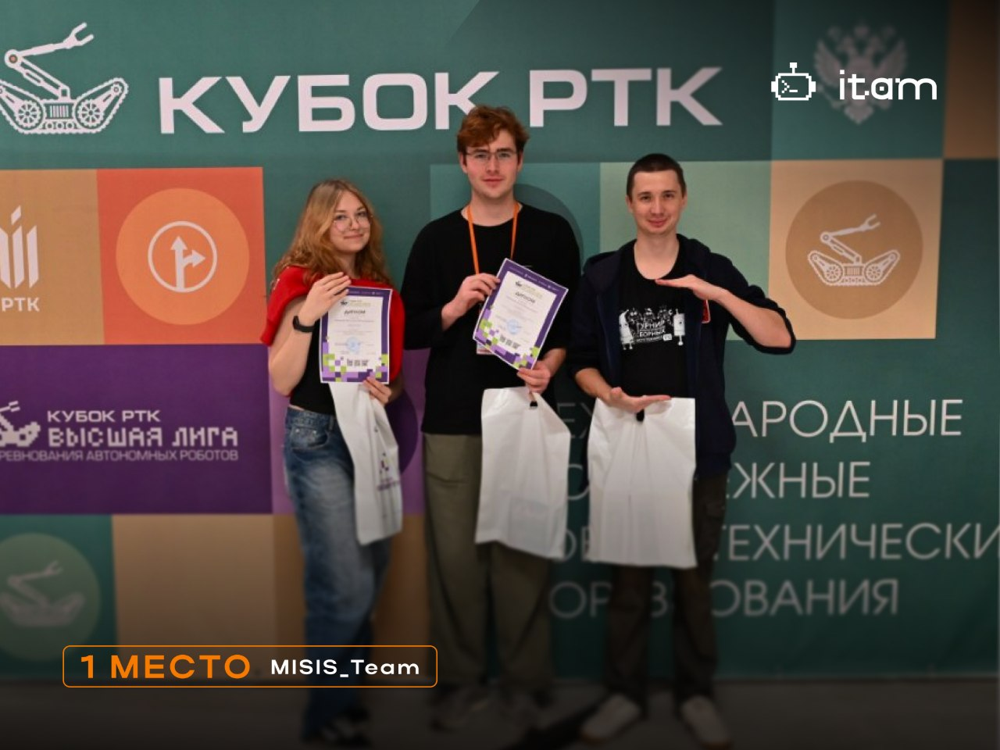
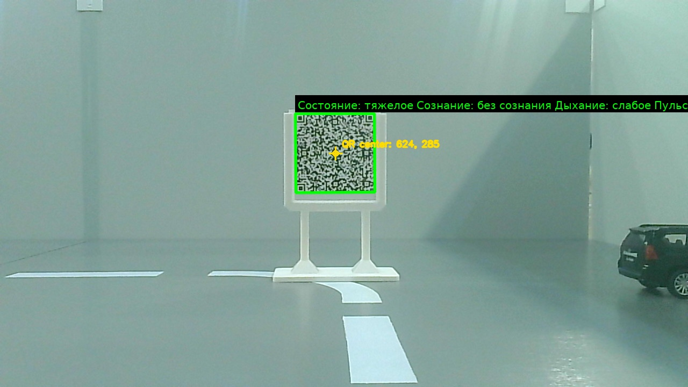
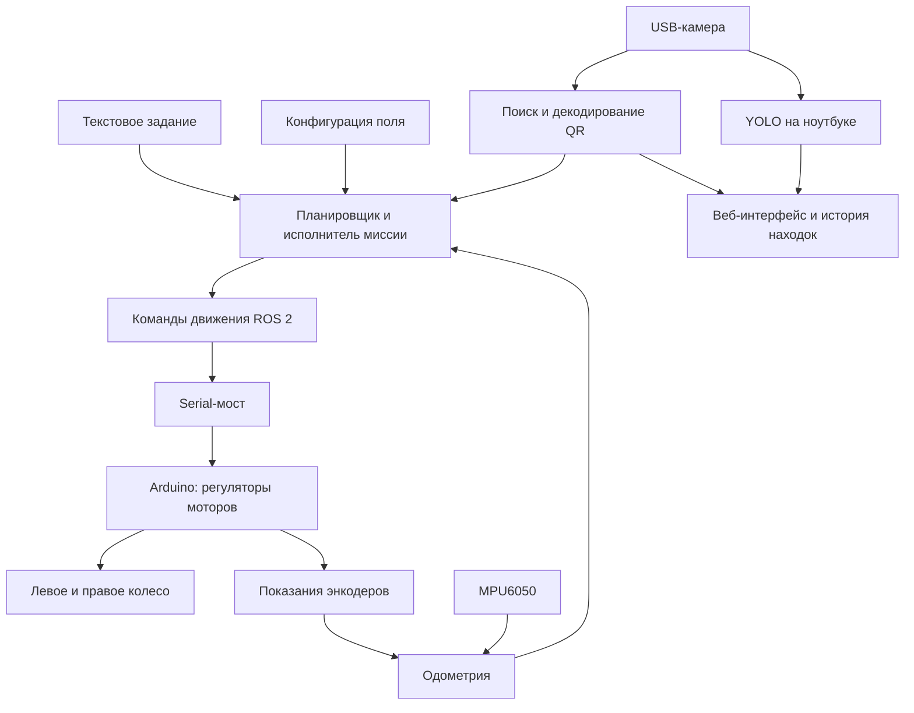

# RTC Evacuation

Программное обеспечение мобильного робота команды **MISIS_Team** для хакатона
**«Эвакуация»** соревнований **«Кубок РТК: Высшая лига»**. Проект объединяет
управление приводом, одометрию, компьютерное зрение и выполнение поисковой
миссии на Raspberry Pi и Arduino.

**Результат — 1 место на «РобоФинисте — 2026», Кронштадт.**

## Робот

В основе решения — открытая мобильная платформа **Frob**, использовавшаяся
командой в проекте [RTK_Gorod](https://github.com/romazanovart/RTK_Gorod).
Два ведущих колеса управляются независимо: робот движется прямо, проходит дуги
и разворачивается на месте. Raspberry Pi исполняет ROS 2-узлы и логику миссии,
Arduino управляет моторами и возвращает показания энкодеров.


*Фотография из раздела «Платформа Frob» репозитория RTK_Gorod.*

| Узел робота | Назначение в «Эвакуации» |
| --- | --- |
| Raspberry Pi | ROS 2, камера, QR-декодирование, маршрут и веб-шлюз |
| Arduino | Регулирование моторов, обработка энкодеров, обмен по Serial |
| Дифференциальный привод | Прямолинейное движение и повороты на месте |
| Энкодеры колёс | Измерение пройденного пути и относительного поворота |
| IMU MPU6050 | Измерение угловой скорости, коррекция курса и поворотов |
| USB-камера | Поиск QR, наведение на стойку и передача изображения |
| Лидар | Доступен в базовой платформе; в профиле эвакуации отключён |
| Ноутбук | YOLO-распознавание объектов и обработка текстового задания |

В конфигурации привода задана колея **180 мм**, в прошивке — диаметр колеса
**67 мм** и **372 отсчёта на оборот**. После полевой калибровки одометрия
использует отдельные коэффициенты левого и правого колеса. Эти значения
относятся к нашему экземпляру и требуют проверки при переносе на другое шасси.

Подключения, кинематика и калибровка: [описание робота](docs/ROBOT.md).

## Команда

Роболаба НИТУ МИСИС.

| Участник | Роль | Направление работы |
| --- | --- | --- |
| [Ромазанов Артём](https://github.com/romazanovart) | Верхний уровень и ROS 2 | Логика миссии, интеграция модулей, веб-управление и выполнение маршрута |
| [Симакова Анастасия](https://github.com/fismay) | Компьютерное зрение и координация | Настройка распознавания, работа с камерой и проверка решения на полигоне |
| [Михайленко Ярослав](https://github.com/yaroslav-yarik) | Нижний уровень и Arduino | Прошивка, управление моторами, энкодеры и отладка движения |



## Задача

Робот получает текстовое описание местонахождения пострадавшего после
чрезвычайной ситуации. Ориентирами служат дома, мосты и объекты происшествия:
ДТП, бензовоз, дерево, остановка или обломки. Нужно добраться до нужной зоны,
найти QR-код пострадавшего, прочитать сведения о его состоянии и вернуться
в точку сбора.

Полигон размером **4 × 4 м** состоит из **25 клеток по 800 × 800 мм**.
Перед заездом сохраняется конфигурация поля. Во время попытки маршрут
исполняется автономно, а камера используется для поиска и чтения QR.

Описание задания: [TASK.md](docs/TASK.md). Организатор и регламенты:
[ГНЦ РФ ЦНИИ РТК](https://cup.rtc.ru/lp/cup-rtc-vishaya-liga/).

## Как робот выполняет задание

1. Разбирает команду, выделяя ориентир и целевой объект.
2. Строит путь от фиксированной стартовой позиции до области поиска.
3. Проходит маршрут: расстояние контролируется по энкодерам, повороты —
   с учётом IMU. Коррекция курса компенсирует различие моторов.
4. В целевой зоне ищет QR или его белую стойку по изображению камеры.
5. Плавно сближается с целью, корректируя направление и пытаясь прочитать QR.
6. После чтения сохраняет кадр с зелёной рамкой и выводит точное содержимое QR.
7. Восстанавливает направление и выполняет возврат по плану миссии.

Текстовая команда обрабатывается лёгким сценарным интерпретатором с поддержкой
синонимов. Эта версия работает без запуска тяжёлой LLM на Raspberry Pi.

## Компьютерное зрение

### QR-код пострадавшего

Детектор разделяет обнаружение цели и чтение данных. Жёлтая рамка означает,
что найдены QR или белая стойка. Зелёная появляется после успешного
декодирования. Состояние пострадавшего берётся из полезной нагрузки QR.



Для сложных кадров используется каскад обработки: серое изображение, поиск
finder-паттернов, выделение ROI, CLAHE, масштабирование, повышение резкости,
адаптивная бинаризация и перспективное выравнивание. Основной декодер —
ZXing-C++. Геометрия OpenCV помогает локализовать цель для наведения.

Декодирование выполняется в отдельном процессе с ограничением времени.
Видеопоток продолжает обновляться, пока декодер обрабатывает кадр.

### Объекты на поле

YOLO worker запускается на ноутбуке и получает свежие кадры от робота.
Поддерживаются классы бензовоза, дерева, ДТП и области QR. Поиск области QR
нейросетью дополняет отдельное декодирование его содержимого.

Результат привязан к исходному кадру одноразовым токеном; устаревшие рамки
отбрасываются. При совпадении ожидаемого и распознанного объекта в чат
прикладывается его снимок. История хранит три последние подтверждённые находки.

## Программная архитектура



Основные технологии: **ROS 2, Python, C++, OpenCV, ZXing-C++, YOLO**.
Взаимодействие модулей: [ARCHITECTURE.md](docs/ARCHITECTURE.md).

## Исходный код

| Компонент | Назначение |
| --- | --- |
| [rover_web](ros2/src/ros2_ws/src/rover_web) | Миссия, QR, управление, веб-шлюз и видеопоток |
| [frob_odometry](ros2/src/ros2_ws/src/frob_odometry) | Энкодерная одометрия и фильтр IMU |
| [frob_control](ros2/src/ros2_ws/src/frob_control) | Передача команд скорости приводу |
| [ros2_arduino_bridge](ros2/src/ros2_ws/src/ros2_arduino_bridge) | Обмен команд и телеметрии с Arduino |
| [frob_sign_detection](ros2/src/ros2_ws/src/frob_sign_detection) | Захват камеры и восстановление потока |
| [frob_bringup](ros2/src/ros2_ws/src/frob_bringup) | Запуск аппаратных узлов |
| [Прошивка Arduino](arduino/arduino_code) | Моторные регуляторы, энкодеры и параметры шасси |
| [object_detector.py](tools/object_detector.py) | Ноутбучный YOLO worker |
| [Инструменты](tools) | Интерпретация команды, калибровка и проверка одометрии |
| [Развёртывание](deployment) | Примеры автозапуска |

## Запуск

Проверенная сборка опубликованных пакетов: **ROS 2 Jazzy, Ubuntu 24.04,
Python 3.12**. Для работы требуются подключённые Arduino, камера и IMU.

```bash
git clone https://github.com/romazanovart/RTC_Evacuation.git
cd RTC_Evacuation
source /opt/ros/jazzy/setup.bash

cd ros2/src/ros2_ws
rosdep install --from-paths src --ignore-src -r -y
colcon build --symlink-install --cmake-args -DPython3_EXECUTABLE=/usr/bin/python3
source install/setup.bash

ros2 launch frob_bringup bringup.launch.py \
  arduino_port:=/dev/ttyACM0 start_lidar:=false
```

В другом терминале из корня репозитория:

```bash
source /opt/ros/jazzy/setup.bash
source ros2/src/ros2_ws/install/setup.bash
ros2 launch rover_web web.launch.py
```

Веб-интерфейс доступен на `http://<robot-host>:8765/`: видео, ручное управление,
статус миссии и результаты распознавания. Подключение QR-зависимостей и модели:
[INSTALL.md](docs/INSTALL.md), [models/README.md](models/README.md).

## Проверка и воспроизводимость

Выполнена сборка всех 11 ROS 2-пакетов. Пройдены 40 тестов маршрута,
сохранения состояния, обнаружения в сети, команд управления и QR-конвейера.
Это проверка опубликованного кода; запуск на другом шасси требует настройки
портов, знаков энкодеров, направления моторов и коэффициентов одометрии.

Веса модели поставляются отдельно. В репозитории находятся исходники и
инструкции по подключению совместимого checkpoint.

## Базовый проект и лицензия

[RTK_Gorod](https://github.com/romazanovart/RTK_Gorod) ·
[Frob_robot](https://github.com/dark516/Frob_robot)

Базовые пакеты сохранены с авторскими уведомлениями. Доработки включают
сценарий эвакуации, QR-наведение, веб-управление, калибровку движения и
разделение вычислений между роботом и ноутбуком.

Код — [Apache License 2.0](LICENSE). Сторонние компоненты сохраняют собственные
лицензии; фотографии и материалы организатора приведены с указанием источника.
