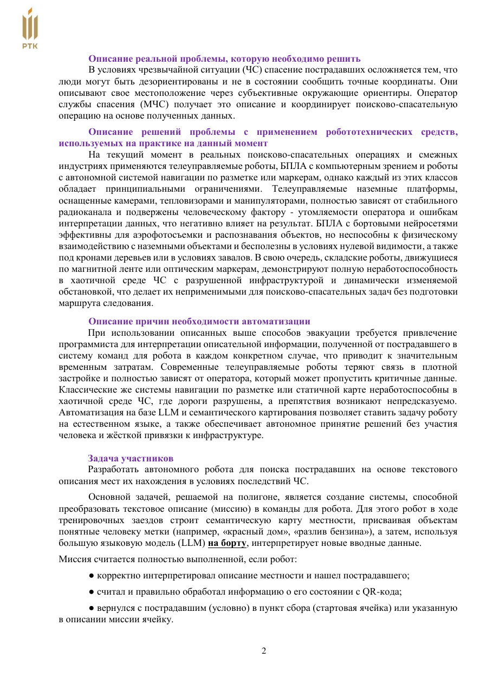

# Задание «Эвакуация»

Этот раздел — краткое изложение официального описания хакатона, а не замена
регламенту. Источник: ГНЦ РФ ЦНИИ РТК, «Описание хакатона „Эвакуация“
Международных молодёжных робототехнических соревнований „Кубок РТК Высшая
лига“», редакция от 13.08.2026.

## Сценарий

В городе произошла чрезвычайная ситуация. Известны приблизительное место и
словесное описание окружения пострадавшего. Автономный робот должен понять
задание, найти человека, считать QR-код с информацией о его состоянии и
вернуться в точку сбора либо в указанную клетку.

Во время тренировочной сессии команда изучает полигон и создаёт семантическую
карту с понятными человеку подписями. В зачётной попытке выдаётся новое
задание на естественном языке; прямое дистанционное управление не является
решением задачи.

## Полигон

- размер 4000 × 4000 мм;
- сетка 5 × 5;
- клетка 800 × 800 мм;
- стены высотой около 400 мм;
- повреждённые здания и два моста;
- дорожная пробка, ПВХ-обломки, перевёрнутый бензовоз и упавшее дерево;
- QR-код пострадавшего расположен на белой стойке.

## Критерий завершения

Робот должен последовательно:

1. интерпретировать описание;
2. построить маршрут по ранее составленной карте;
3. найти пострадавшего;
4. реально декодировать QR-код и обработать данные о состоянии;
5. вернуться в точку сбора или выполнить указанное в миссии завершение.

Актуальные регламенты и материалы следует проверять на
[официальном сайте Кубка РТК](https://cup.rtc.ru/lp/reglament/) и на странице
[Высшей лиги](https://cup.rtc.ru/lp/cup-rtc-vishaya-liga/).
